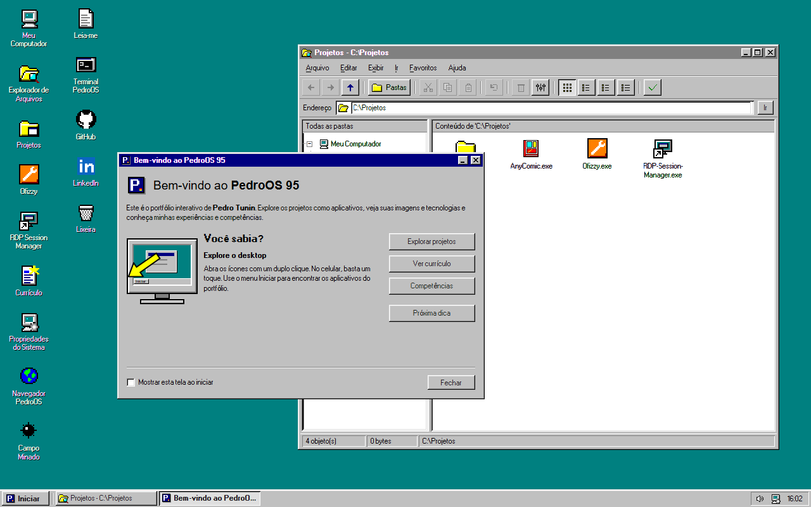
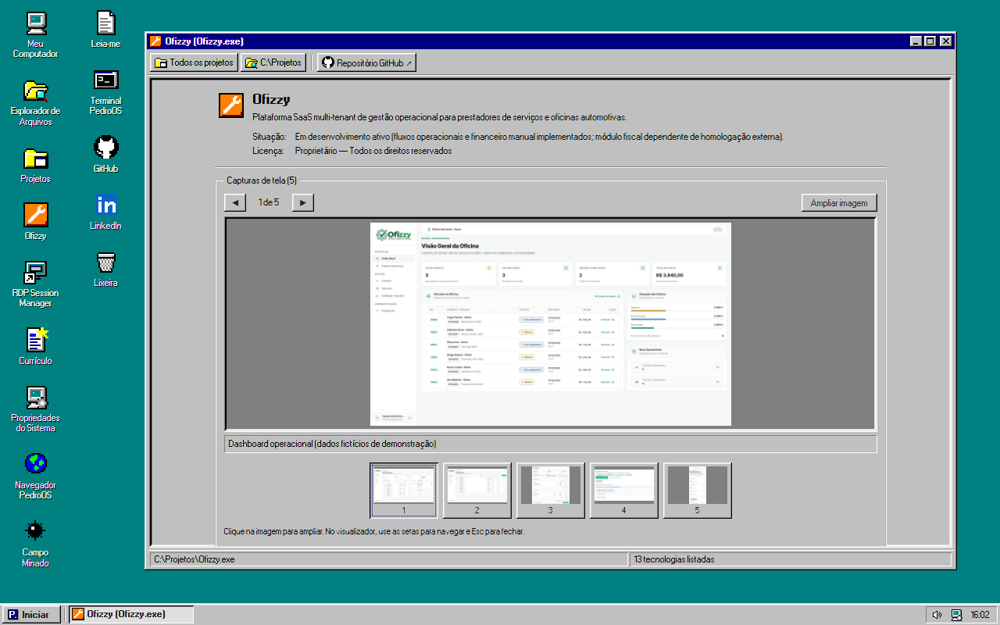
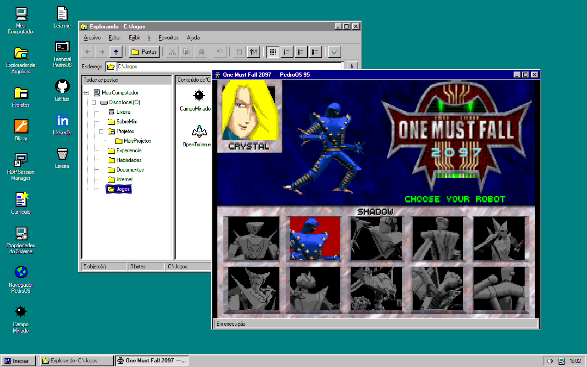
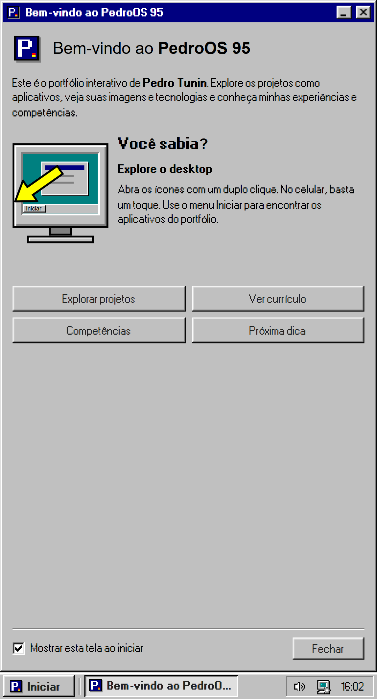
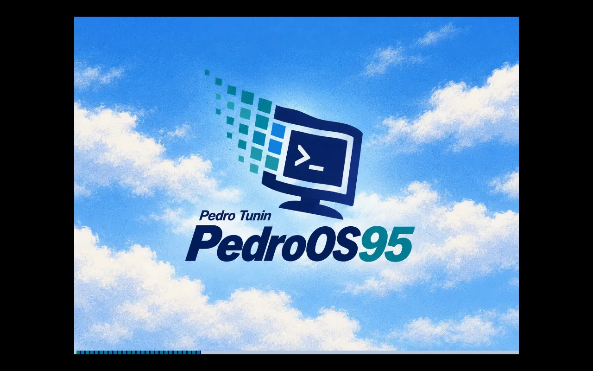
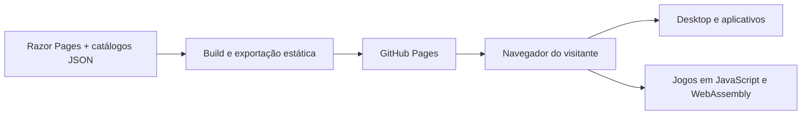

<div align="center">
  

  <h1>PedroOS 95</h1>

  <p><strong>Um portfólio com jeito de sistema operacional.</strong><br>Explore projetos, abra aplicativos e jogue em um desktop inspirado no Windows 95.</p>

  <p>
    <a href="https://github.com/Pedroltz/PedroOS/actions/workflows/ci.yml"></a>
    
    
    
    <a href="LICENSE"></a>
  </p>

  <p>
    <a href="https://pedroltz.github.io/PedroOS/"><strong>Acessar o PedroOS</strong></a> ·
    <a href="#pedroos-em-ação">Ver a experiência</a> ·
    <a href="#comece-por-aqui">Executar localmente</a> ·
    <a href="#documentação">Documentação</a>
  </p>
</div>

<br>



## Conheça o trabalho. Explore o sistema.

O **PedroOS 95** é o portfólio interativo de **Pedro Tunin**. Projetos aparecem como
programas, o currículo abre em uma janela própria e as habilidades podem ser
exploradas nas Propriedades do Sistema. A navegação faz parte da experiência:
menu Iniciar, arquivos virtuais, terminal e janelas independentes.

O site funciona diretamente no navegador, em computador ou celular. Os jogos
usam o processamento de quem está jogando; a hospedagem pública serve apenas
arquivos estáticos pelo GitHub Pages.

| Recurso | O que você encontra |
| --- | --- |
| **Portfólio navegável** | Projetos com descrição, tecnologias, capturas de tela e links para os repositórios. |
| **Desktop clássico** | Janelas com arraste, redimensionamento, minimizar, maximizar e barra de tarefas. |
| **Currículo e habilidades** | Currículo para download em PDF, competências e experiências organizadas como aplicativos. |
| **Explorador e terminal** | Pastas virtuais em `C:\`, leitura de arquivos e comandos como `DIR`, `CD`, `TYPE` e `START`. |
| **Jogos no navegador** | DOOM / Freedoom, Campo Minado, SkiFree, OpenTyrian e One Must Fall 2097. |
| **Inicialização e descobertas** | Abertura automática com identidade própria, protetor de tela e pistas espalhadas pelo sistema. |
| **Desktop e celular** | Janelas livres em telas maiores e controles adaptados para toque. |

## PedroOS em ação

Capturas reais da versão em desenvolvimento, feitas a partir da exportação
estática local. [Como atualizar as imagens](docs/assets/README.md).

### Projetos apresentados como aplicativos

Cada projeto tem sua própria janela, com tecnologias, contexto e uma galeria que
permite ampliar as imagens originais.



### Jogos que fazem parte do desktop

Abra **Meu Computador → C:\Jogos**. Os motores e arquivos de cada jogo são
carregados somente quando você inicia a partida. Ao minimizar ou trocar de
janela, o jogo e seu áudio ficam pausados; ao fechar, o motor é descartado.



<details>
  <summary><strong>Jogos disponíveis e controles</strong></summary>

| Executável | Experiência |
| --- | --- |
| `Doom.exe` | Chocolate Doom com Freedoom: Phase 1, com opção de carregar seu próprio IWAD. Também abre com `doom` no terminal. |
| `CampoMinado.exe` | Campo Minado com níveis Iniciante, Intermediário e Avançado. |
| `SkiFree.exe` | Esqui clássico com controles de teclado e toque. |
| `OpenTyrian.exe` | Ação espacial com o motor OpenTyrian compilado para WebAssembly. |
| `OneMustFall2097.exe` | Luta entre robôs no jogo original, executado com DOSBox no navegador. |

Freedoom precisa de aproximadamente 35 MB no primeiro carregamento. O desempenho
depende do dispositivo do visitante. Os controles aparecem no lançador de cada
jogo; licenças e fontes acompanham suas distribuições.

</details>

<div align="center">
  <h3>A experiência também cabe no celular</h3>
  <p>A interface ajusta as janelas e os controles para navegação por toque.</p>
  
</div>

<details>
  <summary><strong>Uma inicialização com identidade própria</strong></summary>

A abertura começa com logs em fundo preto e fonte IBM VGA 8×16, passa pela
apresentação do PedroOS e entra automaticamente no desktop. O som clássico é
tentado na transição; se o navegador bloquear áudio automático, a entrada segue
silenciosamente. **Esc** permite pular a sequência.



</details>

## Arquitetura

**.NET 10 e Razor Pages** geram o HTML, os fragmentos das janelas e o currículo PDF
durante o build. O **TypeScript** controla o desktop e seus aplicativos. Depois
da exportação, o site publicado funciona sem um servidor .NET em execução.



| Camada | Tecnologias |
| --- | --- |
| **Geração das páginas** | C#, ASP.NET Core Razor Pages e catálogos JSON. |
| **Interface e interação** | TypeScript, 98.css, interact.js, HTML e CSS. |
| **Jogos** | Canvas, WebAssembly, Chocolate Doom, OpenTyrian e DOSBox. |
| **Build e imagens** | esbuild e Sharp, com prévias e miniaturas em WebP. |
| **Qualidade e publicação** | xUnit, Playwright e GitHub Actions. |

A abertura é verificada com um orçamento de **até 1 MiB de recursos**, sem baixar
jogos antecipadamente. As capturas do portfólio usam prévias leves e preservam os
originais para ampliação. [Medições e metodologia](docs/PERFORMANCE.md).

## Comece por aqui

**Pré-requisitos:** Node.js 24 e .NET SDK 10. Na raiz do repositório:

```sh
npm ci
npm run dev
```

Abra o endereço informado pelo ASP.NET Core, normalmente
**http://localhost:5159**. Os catálogos de projetos, habilidades e perfil ficam em
[`src/PedroOS.Web/Data`](src/PedroOS.Web/Data).

Para gerar a versão estática e conferir o mesmo formato servido pelo Pages:

```sh
npm run build
dotnet build PedroOS.slnx -c Release
npm run export:pages -- --base /PedroOS --site https://pedroltz.github.io
npm run preview:pages
```

A prévia abre em **http://127.0.0.1:5170/PedroOS/**. Comandos de testes,
configuração do Pages e detalhes das importações estão no
[guia de desenvolvimento](docs/DEVELOPMENT.md).

## Organização do repositório

```text
PedroOS/
├── .github/workflows/     # Validação e publicação no GitHub Pages
├── artwork/              # Arte original, fora da pasta publicada
├── docs/                 # Guias, medições e capturas do projeto
├── scripts/              # Build, exportação, imagens e importação dos jogos
├── src/PedroOS.Web/
│   ├── Client/           # Desktop, aplicativos e componentes TypeScript
│   ├── Data/             # Projetos, perfil, habilidades e ícones
│   ├── Pages/            # Shell e componentes Razor
│   └── wwwroot/          # Recursos estáticos e motores dos jogos
├── tests/                # Testes .NET, de cliente e de interface
└── PedroOS.slnx          # Solução .NET
```

## Qualidade e publicação

O CI verifica build, TypeScript, lint, testes de cliente e testes .NET. A interface
é exercitada pelo Playwright em desktop e emulação móvel, tanto no servidor de
desenvolvimento quanto na exportação estática, sem backend.

O desenvolvimento acontece na `develop`. Alterações integradas à `main` passam
pela validação e são publicadas pelo workflow
[CI & Deploy (GitHub Pages)](.github/workflows/ci.yml).

## Documentação

| Guia | Conteúdo |
| --- | --- |
| [Desenvolvimento](docs/DEVELOPMENT.md) | Execução local, testes, exportação, publicação, comandos e recursos do sistema. |
| [Desempenho](docs/PERFORMANCE.md) | Orçamento de carregamento, medições e metodologia. |
| [Capturas do projeto](docs/assets/README.md) | Como reproduzir e atualizar as imagens deste README. |
| [Créditos e licenças](THIRD_PARTY_NOTICES.md) | Dependências, motores, dados dos jogos, fontes e áudio. |
| [Arte de inicialização](src/PedroOS.Web/wwwroot/assets/boot/ARTWORK.md) | Procedência e prompt da apresentação do PedroOS. |

## Licença

O código do PedroOS está disponível sob a [licença MIT](LICENSE). Jogos, fontes,
áudio e outros materiais de terceiros mantêm suas próprias licenças e direitos,
descritos em [THIRD_PARTY_NOTICES.md](THIRD_PARTY_NOTICES.md).

PedroOS é um portfólio pessoal inspirado na interface do Windows 95, sem afiliação
com a Microsoft.

<div align="center">
  <sub>Desenvolvido por <a href="https://github.com/Pedroltz">Pedro Tunin</a>.</sub>
</div>
